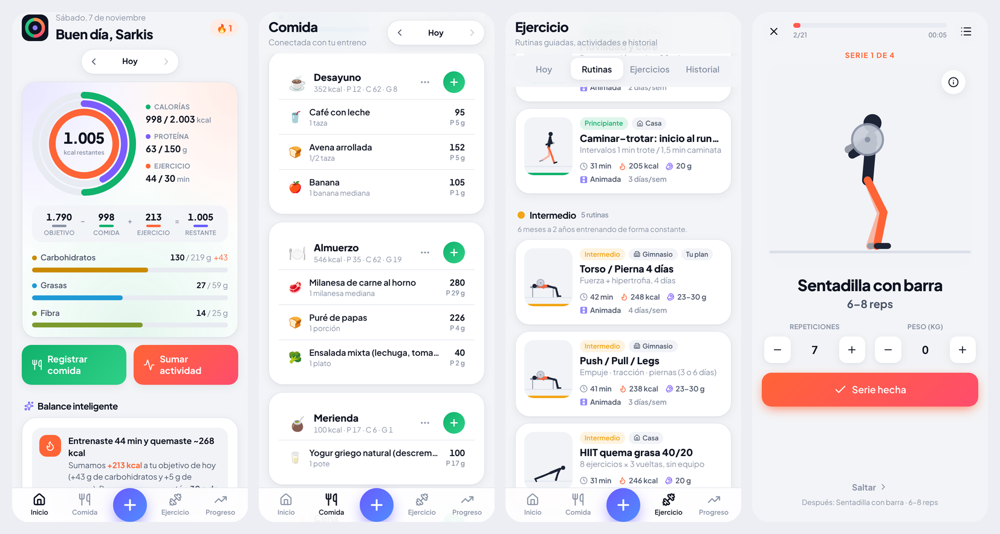

# appGIM · Comida + Entrenamiento

App web gratuita (PWA) para registrar **lo que comés** y **lo que entrenás**, con los dos módulos conectados:

- Si entrenás, la app suma a tu objetivo del día las calorías que quemaste y te sugiere la proteína para recuperarte.
- Si comés de más, te muestra cuánto movimiento equivale y te deja registrar una actividad.
- Todo funciona **offline**, **sin cuentas** y **sin costos**: los datos quedan en tu teléfono (con backup a archivo).

> Abrila en el celular, tocá *“Agregar a pantalla de inicio”* y se usa como una app más.



## Qué incluye

### 🍽️ Módulo Comida
- **525 alimentos en español** con valores por 100 g: 298 de **USDA FoodData Central** (dominio público) y 227 platos y productos típicos estimados por receta o rótulo (milanesas, empanadas, asado y achuras, pastas, guisos, sándwiches, tartas, mate, alfajores, golosinas, suplementos…). Incluye versiones **crudas para pesar** (pollo, carne, arroz, legumbres, papa).
- Porciones reales (“1 milanesa mediana”, “1 empanada”, “1 taza”…), recientes y favoritos primero.
- **Buscador tolerante**: plurales (“huevos”), errores de tipeo (“milaneza”) y nombres de otros países (aguacate → palta, frijoles → porotos, fresa → frutilla, hot dog → pancho).
- **Productos de supermercado** vía [Open Food Facts](https://world.openfoodfacts.org) (gratis, sin clave): se busca solo si no está en la base, y muestra **Nutri-Score** y grado de procesamiento (NOVA).
- **Escáner de códigos** con la cámara: EAN, UPC (incluido UPC-E), cajas ITF-14, GS1-128/DataBar y los **QR nuevos de los envases** (GS1 Digital Link). Linterna, zoom, cambio de cámara, foco al tocar, **lectura desde una foto** y compatible con **lectores USB/Bluetooth**. Nativo en Android; en iPhone y PC usa ZXing en WebAssembly.
- Si el producto no está o no tiene tabla: **“Leer la tabla nutricional con la cámara”** (OCR con Tesseract.js, corre en el teléfono): endereza la foto, borra las líneas de la tabla, entiende rótulos del Mercosur con columnas “100 g / porción” y corrige errores típicos (comas perdidas, la “g” leída como 9) validando contra las calorías. Queda guardado con su código para la próxima.
- Fibra del día, y en cada alimento azúcares, grasas saturadas y sodio cuando hay datos.
- Alimentos propios, **comidas guardadas** para cargar con un toque, copiar la comida de ayer, agregado rápido de calorías.
- Desayuno, almuerzo, **merienda**, cena y snacks. Agua por vasos.
- Cada alimento muestra su **equivalencia en ejercicio** (“= 25 min caminando rápido”).

### 🏋️ Módulo Ejercicio
- **17 rutinas** en tres niveles, cada una con **tiempo, calorías y proteína calculados para tu peso** y **animación propia en todos los ejercicios** (82 ejercicios, figuras SVG animadas con cinemática inversa: funcionan sin internet).

| Nivel | Rutinas |
|---|---|
| 🌱 Principiante | Primeros pasos en casa · Rutina científica de 7 minutos · Gimnasio inicial con máquinas · Fuerza base 5×5 · Movilidad y core · Caminar–trotar (inicio al running) |
| 🔥 Intermedio | Torso / Pierna 4 días · Push / Pull / Legs · HIIT 40/20 · Calistenia intermedia · Mancuernas en casa |
| 🏆 Avanzado / Pro | PHUL · PPL hipertrofia 6 días · Fuerza 5/3/1 · Calistenia avanzada · Metcon funcional · Atleta híbrido (carrera + fuerza) |

Valores calculados por la app para una persona de **70 kg** (se recalculan con tu peso):

| Nivel | Rutina | Lugar | Días/sem | Min/sesión | kcal/sesión | kcal/semana | Proteína post | Animación |
|---|---|---|---|---|---|---|---|---|
| 🌱 Principiante | Primeros pasos en casa | Casa | 3 | 29–30 | 128–132 | ~390 | 21 g | ✅ 12/12 |
| 🌱 Principiante | Rutina científica de 7 minutos | Casa | 3 | 20 | 134 | ~400 | 20 g | ✅ 12/12 |
| 🌱 Principiante | Gimnasio inicial con máquinas | Gimnasio | 3 | 34 | 137–140 | ~420 | 21 g | ✅ 12/12 |
| 🌱 Principiante | Fuerza base 5×5 | Gimnasio | 3 | 34–43 | 184–238 | ~660 | 21 g | ✅ 5/5 |
| 🌱 Principiante | Movilidad y core | Casa | 2 | 19 | 56 | ~110 | 20 g | ✅ 8/8 |
| 🌱 Principiante | Caminar–trotar: inicio al running | Casa | 3 | 31 | 191 | ~570 | 20 g | ✅ 2/2 |
| 🔥 Intermedio | Torso / Pierna 4 días | Gimnasio | 4 | 37–45 | 203–250 | ~930 | 21–28 g | ✅ 24/24 |
| 🔥 Intermedio | Push / Pull / Legs | Gimnasio | 3 | 38–42 | 207–232 | ~670 | 21–28 g | ✅ 17/17 |
| 🔥 Intermedio | HIIT quema grasa 40/20 | Casa | 3 | 31 | 230 | ~690 | 20 g | ✅ 8/8 |
| 🔥 Intermedio | Calistenia intermedia | Casa | 3 | 47–50 | 326–349 | ~1020 | 28 g | ✅ 11/11 |
| 🔥 Intermedio | Mancuernas en casa | Casa | 3 | 41–46 | 167–186 | ~540 | 28 g | ✅ 12/12 |
| 🏆 Avanzado | PHUL: potencia + hipertrofia | Gimnasio | 4 | 48–56 | 308–367 | ~1340 | 28 g | ✅ 22/22 |
| 🏆 Avanzado | PPL hipertrofia 6 días | Gimnasio | 6 | 43–49 | 281–323 | ~1810 | 28 g | ✅ 29/29 |
| 🏆 Avanzado | Fuerza 5/3/1 | Gimnasio | 4 | 37 | 229–232 | ~930 | 28 g | ✅ 8/8 |
| 🏆 Avanzado | Calistenia avanzada | Casa | 4 | 46–54 | 354–430 | ~1570 | 28 g | ✅ 10/10 |
| 🏆 Avanzado | Metcon funcional | Gimnasio | 3 | 35 | 280 | ~840 | 20 g | ✅ 6/6 |
| 🏆 Avanzado | Atleta híbrido: carrera + fuerza | Casa | 4 | 46–53 | 350–428 | ~1550 | 20–28 g | ✅ 9/9 |

- **Calorías**: MET de la sesión (Compendio 2024) × peso × duración. La **duración** sale de series × repeticiones × ~3 s + descansos + cambios + calentamiento.
- **Proteína post‑entreno**: 0,25 g/kg (movilidad/cardio), 0,30 g/kg (fuerza moderada) o 0,40 g/kg (fuerza intensa o de mucho volumen), según el rango de la ISSN.
- **Animación**: todos los ejercicios tienen animación propia (figura SVG), sin depender de internet ni de servicios pagos.

- **Entrenamiento guiado**: animación grande, series y repeticiones, registro de peso por serie (“la última vez hiciste…” y sugerencia de progresión), temporizadores de trabajo/descanso, pitidos 3‑2‑1, **voz guía en español**, vibración y pantalla siempre encendida.
- **Plan de entrenamiento semanal** (“Hoy te toca…”), historial con mapa de calor, récords (1RM estimado) y **creador de rutinas propias**.
- **Actividades rápidas**: caminar, correr, bici, natación, fútbol, pádel, tenis, básquet, vóley, boxeo, yoga, baile, soga… con METs oficiales.

### ⚖️ Balance (la fusión)
- **Objetivo − Comida + Ejercicio = Restante**, en anillos (calorías, proteína, minutos de ejercicio).
- En días de entrenamiento suben las calorías (80% carbohidratos, 20% grasas), el agua (+500 ml/h) y se recomienda la proteína post‑entreno.
- **Balance inteligente**: avisos y sugerencias de comidas para completar tu proteína sin pasarte de calorías.

### 📈 Progreso
- Peso con **línea de tendencia**, meta, IMC; semana de calorías vs. objetivo; minutos activos vs. los 150 de la OMS.
- **Gasto real adaptativo**: con tus registros de comida y peso estima tu metabolismo real (lo que hacen apps pagas como MacroFactor).
- Logros y racha de días (los logros ganados quedan guardados).
- **Medidas corporales** (cintura, pecho, cadera, brazo, muslo) con gráfico, y **fotos de progreso** con comparación “antes y ahora”. Las fotos se guardan solo en el dispositivo.
- **Gráfico de fuerza por ejercicio** (1RM estimado, o mejor serie si es sin peso).

### 🧰 Además
- **Recetas**: armás un plato con ingredientes y gramos, decís cuántas porciones rinde y la app calcula cada porción.
- **Plan semanal de comidas**: menú de 7 días ajustado a tus calorías y proteína (opción vegetariana), cada comida se puede cambiar o registrar con un toque, y sale la **lista de compras** para compartir.
- **Copiar un día completo** de comidas y editar tus alimentos propios.
- **Entrenamiento a prueba de cortes**: si se cierra la app o tocás “atrás”, lo retomás donde quedó. En los ejercicios “por lado” el reloj cuenta los dos lados y avisa cuándo cambiar.
- **Historial estable**: si cambiás tu peso u objetivo, los días pasados conservan el objetivo que tenían.
- **Backup** con recordatorio cada 2 semanas y confirmación antes de restaurar.

## Cómo calculamos (fuentes)

| Qué | Método | Fuente |
|---|---|---|
| Metabolismo basal | Mifflin‑St Jeor | Mifflin et al., 1990 |
| Gasto diario | Basal × factor de actividad **sin** entrenamientos (se suman aparte) | — |
| Calorías del ejercicio | kcal = MET × kg × horas; al objetivo se suman las netas (MET − 1) | [Compendio de Actividades Físicas para Adultos 2024](https://pacompendium.com) (Herrmann et al.) |
| Proteína | 1,6–2,0 g/kg según objetivo; ~0,3 g/kg post‑entreno | [ISSN Position Stand, 2017](https://jissn.biomedcentral.com/articles/10.1186/s12970-017-0177-8); Morton et al., 2018 |
| Frecuencia y volumen | Novatos 2–3 días, intermedios 3–4, avanzados 4–6 | ACSM Position Stand, 2009 |
| Déficit / superávit | ~7.700 kcal por kg | — |
| Fibra / agua | 14 g cada 1.000 kcal / ~35 ml por kg + 500 ml por hora de ejercicio | Guías Alimentarias EE.UU.; ACSM |
| Alimentos | USDA FoodData Central SR Legacy | [fdc.nal.usda.gov](https://fdc.nal.usda.gov) |
| Productos | Open Food Facts (ODbL) | [openfoodfacts.org](https://world.openfoodfacts.org) |
| Lectura de etiquetas | Tesseract.js + idioma español (Apache 2.0) | [tesseract.projectnaptha.com](https://tesseract.projectnaptha.com) |

Las rutinas se basan en: Klika y Jordan (2013, “7 minutos”), StrongLifts 5×5 / Starting Strength, PPL de r/Fitness, PHUL (Brandon Campbell), 5/3/1 de Jim Wendler, Couch to 5K y la rutina recomendada de r/bodyweightfitness.

> ⚠️ Son estimaciones educativas, no reemplazan el consejo de un médico o nutricionista.

## Publicarla gratis (GitHub Pages)

1. En GitHub: **Settings → Pages → Build and deployment → Source: “Deploy from a branch”**, rama **`gh-pages`**, carpeta **`/ (root)`** → **Save** (solo una vez).
2. Cada vez que hay un cambio en `main`, el workflow `.github/workflows/deploy.yml` corre los tests, compila y sube el resultado a la rama `gh-pages`.
3. La app queda en `https://<tu-usuario>.github.io/appGIM/`.

## Desarrollo

Requiere Node 22+.

```bash
npm install
npm run dev        # servidor local en http://localhost:5173
npm test           # tests de cálculos y de integridad de datos
npm run build      # compila a dist/
```

Galería de control de animaciones (solo en desarrollo): `http://localhost:5173/#/dev`.

### Estructura

```
src/
  data/        alimentos (generado), ejercicios, animaciones, rutinas, actividades
  lib/         cálculos de nutrición y entrenamiento, búsqueda, Open Food Facts, sonidos/voz
  store/       estado persistente (zustand + localStorage) y datos derivados del día
  components/  UI, gráficos SVG y el motor de figuras animadas
  features/    inicio (balance), comida, ejercicio (rutinas, reproductor), progreso, perfil
scripts/build_foods.py   regenera src/data/foods.ts desde el CSV de USDA
```

Tecnologías (todas libres): React, TypeScript, Vite, Tailwind CSS, Zustand, Lucide, vite‑plugin‑pwa, barcode‑detector/ZXing.
